# Sound Clash – Bericht: Handy-Modus und neues Design

Hallo Tim, deine Wünsche sind umgesetzt. Live ist noch nichts geändert; dafür brauchst du nur einen
Klick (ganz unten).

## Kurz gesagt

- **Neue Wahl am Anfang – „Spielweise“:** **Nur Hauptgerät** (alles wie bisher) oder **📱 Mit Handys**.
- **Handy-Modus:** Die Spieler machen alles am eigenen Handy: Rad drehen, blind setzen, Song aussuchen,
  abstimmen. Der Hauptbildschirm (z. B. MacBook) ist die große Bühne:
  1. **Ziehen:** groß das Rad, darunter die Plätze des Spielers am Zug, unten klein die anderen.
  2. **Songwahl:** alle wählen **gleichzeitig** am Handy. Am Hauptgerät stehen nur Kacheln
     nebeneinander: „P1 wählt …“ / „✓ bereit“. Kein Ausklappmenü.
  3. **„Alle haben gewählt“:** Bildschirm mit allen gewählten Songs (wer, Titel, Künstler).
  4. **Abspielen:** Die Songs laufen **nacheinander** am Hauptgerät, automatisch je **30 Sekunden**.
     Die Reihenfolge rückt mit jedem Duell um eins weiter (P1-P2-P3, dann P2-P3-P1, …).
     Das Hin und Her gibt es nur noch beim Verteilen der Künstler.
  5. **Abstimmen am Handy**, schon während die Songs laufen: Jede Karte zeigt groß, **wer** den Song
     gewählt hat, und der laufende Song ist mit „▶ läuft gerade“ markiert.
  6. Danach entscheidet ihr wie gewohnt am Hauptgerät. Punkte und Regeln sind unverändert.
- **Zuschauer können jederzeit dazukommen**, auch mitten in der Runde: unten rechts steht dafür ein
  kleiner QR-Code „Mit abstimmen“.
- **Ganz neues Handy-Design:** dunkle Bühne mit Farbverlauf, große Status-Karte in der Spielerfarbe,
  Glas-Karten, große Knöpfe, „Jetzt“ / „Mein Line-up“ als Umschalter.
- **Schallplatte:** jetzt realistisch, mit feinen Rillen, Liedpausen-Ringen, stehendem Glanz und dem
  Album-Cover als rundem Etikett mit Mittelloch. Sie dreht ruhiger (eine Umdrehung in etwa 4,5 Sekunden).
- **Hintergrund:** Das Künstler-Mosaik zieht langsam nach links, und es rücken laufend neue Künstler nach.
  Die Album-Farbschemas sind geblieben.

## Geprüft

- Der klassische Modus „Nur Hauptgerät“ verhält sich weiter **exakt wie das Original**. Alle
  Vergleichstests sind grün. Einzige Änderung in den gespeicherten Einstellungen: der neue Eintrag
  `phoneMode`.
- Neuer Test mit **echtem Koppeln per QR-Code** (Hauptgerät + 2 Spieler-Handys + 1 Zuschauer über
  das Internet): Drehen und Setzen nur am Handy, gleichzeitige Songwahl mit „Fertig“, Zuschauer kommt
  mitten in der Runde dazu, „Alle haben gewählt“, Songs nacheinander, „läuft gerade“ am Handy, Abstimmen.
- Neue Logik-Tests für die Reihenfolge (rückt pro Duell um eins weiter) und „Fertig“/„Song ändern“.

## Bilder

In den Test-Bildern sind Cover durch Platzhalter ersetzt; in der App siehst du die echten Cover.

Handy-Modus am Hauptgerät:

| Einrichtung mit QR-Code | Ziehen: Rad + Spieler am Zug |
|---|---|
| 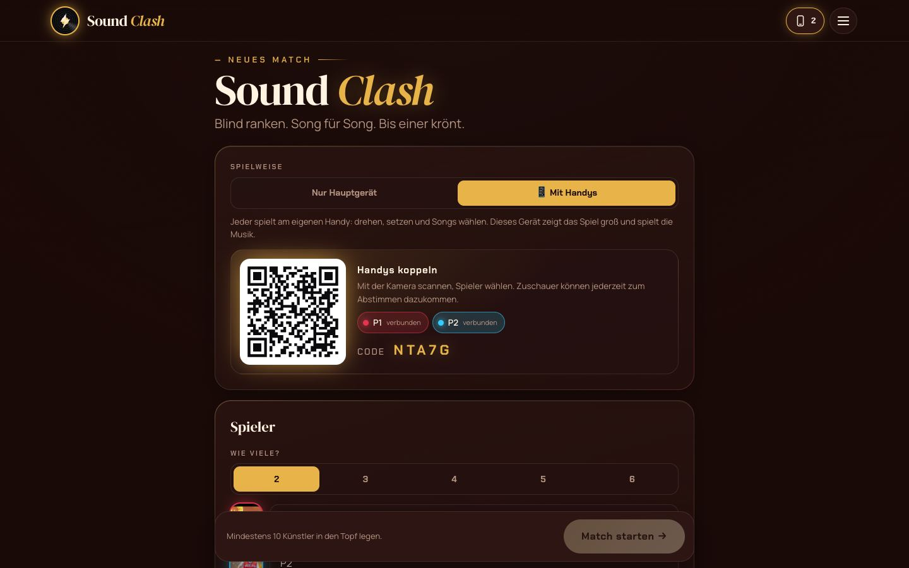 | 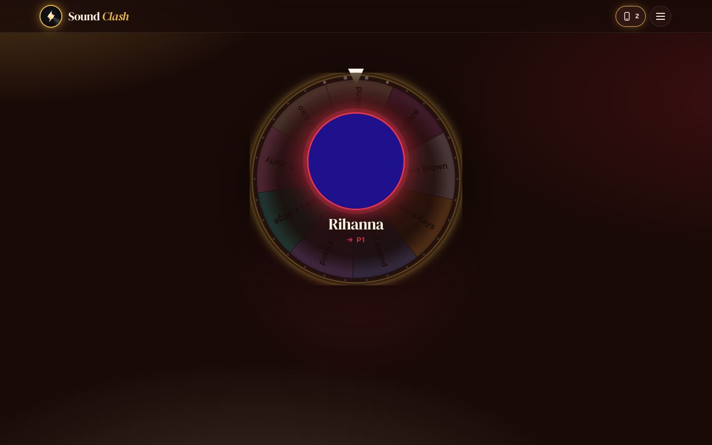 |
| **Songwahl: Kacheln** | **Alle haben gewählt** |
| 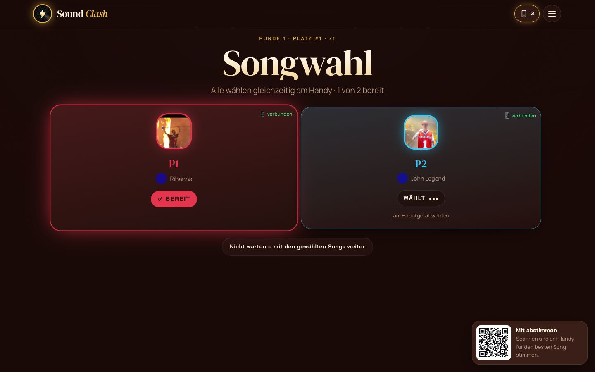 | 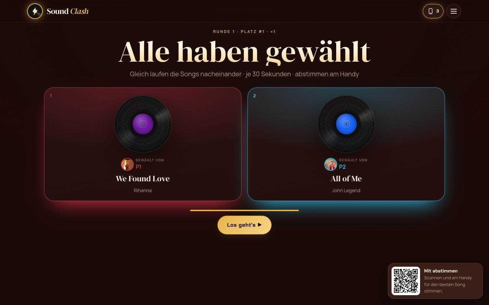 |
| **Song läuft (gewählt von …)** | **Entscheidung** |
| 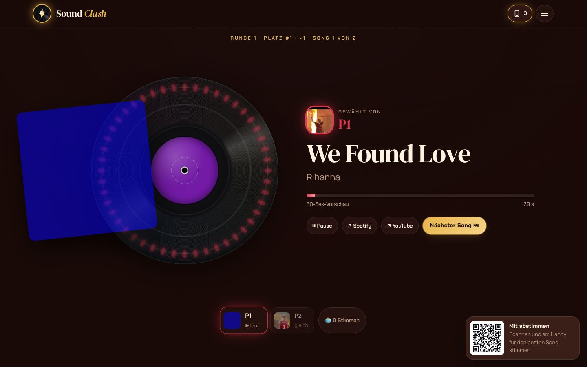 | 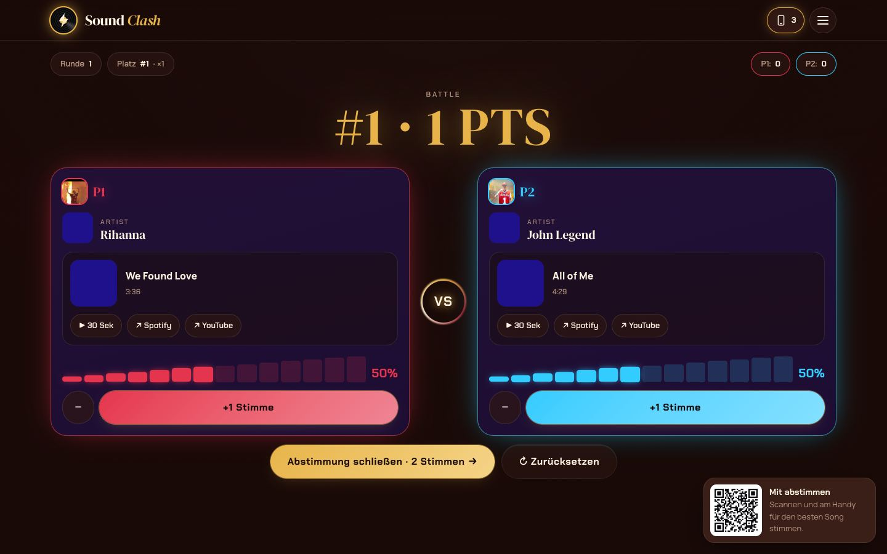 |

Am Handy:

| Wer bist du? | Rad drehen | Blind setzen | Song wählen |
|---|---|---|---|
| 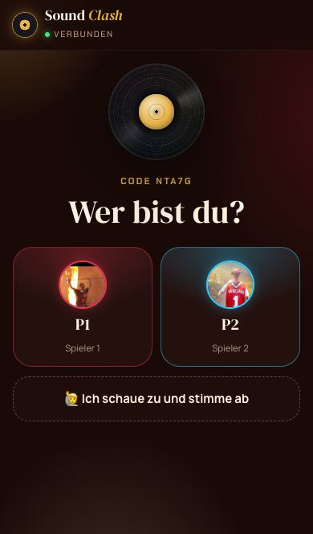 | 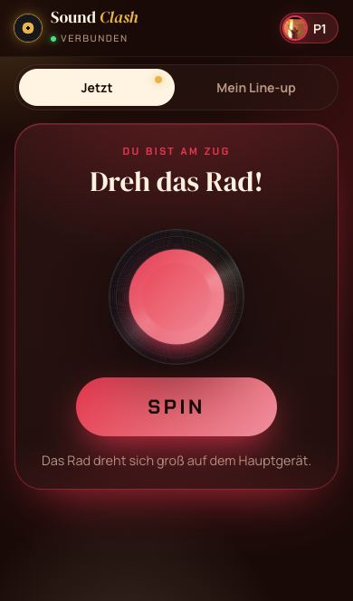 | 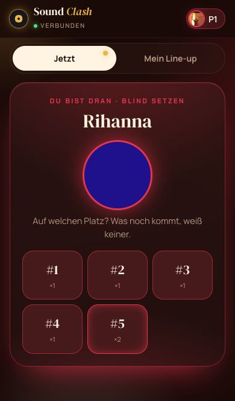 | 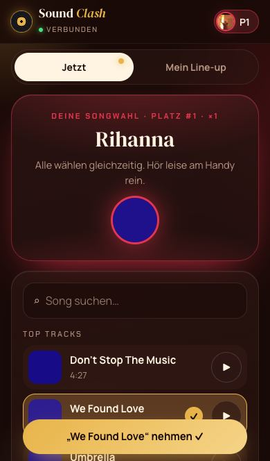 |
| **Bereit** | **Läuft gerade (Zuschauer)** | **Abstimmen** | |
| 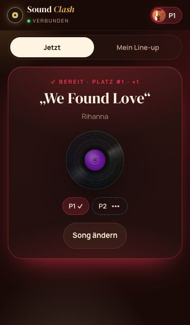 | 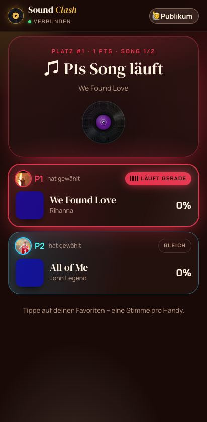 | 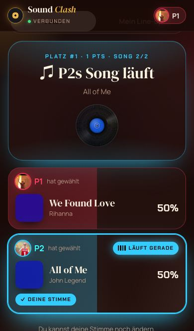 | |

Klassischer Modus (Mac und iPhone):

| Mac | iPhone |
|---|---|
|  |  |
|  |  |
|  |  |
|  |  |

## So spielst du im Handy-Modus

1. Am MacBook die App öffnen → oben **Spielweise: 📱 Mit Handys**.
2. Jeder scannt den QR-Code mit der iPhone-Kamera und tippt auf seinen Namen. Am MacBook steht dann
   „verbunden“. Wer nur abstimmen will, tippt „Ich schaue zu und stimme ab“.
3. Künstler in den Topf legen → **Match starten**. Ab jetzt läuft alles über die Handys.
4. Ist ein Handy mal nicht verbunden, geht es für diesen Spieler wie gewohnt am MacBook weiter
   („am Hauptgerät wählen“, „Nicht warten“).

Tipp: Am zuverlässigsten klappt die Verbindung, wenn alle im selben WLAN sind.

## Deine nächsten Schritte (veröffentlichen)

1. **GitHub Desktop** öffnen. Oben sollte bei **Current Branch** schon **`main`** stehen
   (sonst draufklicken und `main` wählen).
2. Oben rechts **Push origin** klicken.
3. Im Browser **github.com/v6fdb8msrw-dotcom/SoundClashBeta** → oben **Actions**. Warten, bis der
   oberste Eintrag einen grünen Haken hat (etwa 2–3 Minuten).
4. **v6fdb8msrw-dotcom.github.io/SoundClashBeta/?neu=1** öffnen. Das `?neu=1` umgeht den
   Browser-Zwischenspeicher. Am iPhone die App einmal ganz schließen und neu öffnen.

## Eine Frage an dich

Im **klassischen Modus** („Nur Hauptgerät“) wählen die Spieler ihre Songs weiter wie im Original
abwechselnd hin und her (Duell 1: P1 → P2 → P3, Duell 2: P3 → P2 → P1). Im Handy-Modus rückt die
Reihenfolge jetzt immer um eins weiter. Soll das „immer eins weiter“ auch im klassischen Modus gelten?
