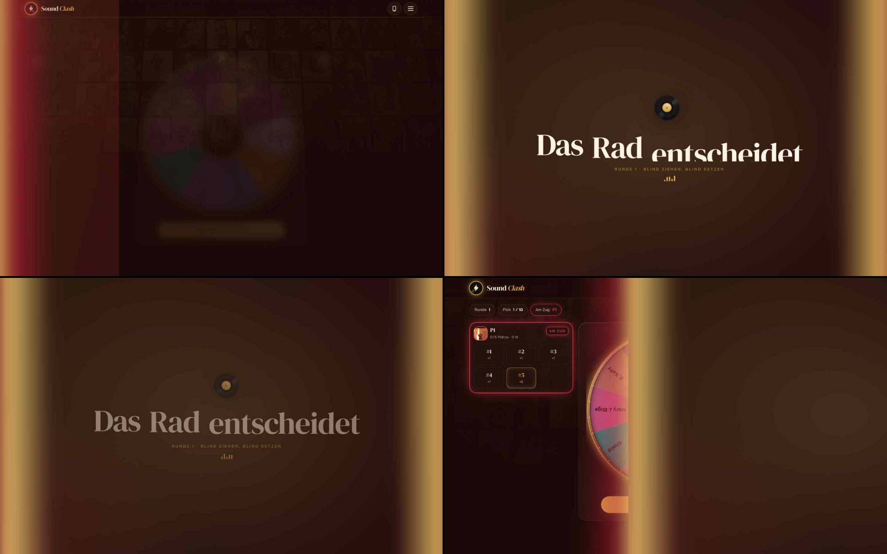
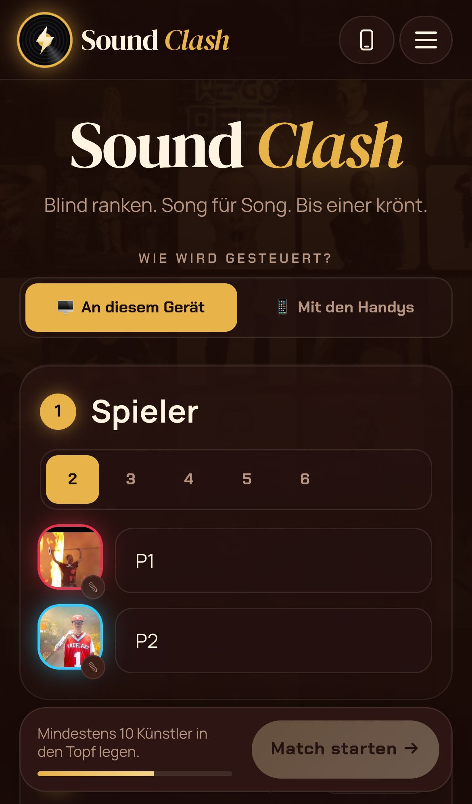
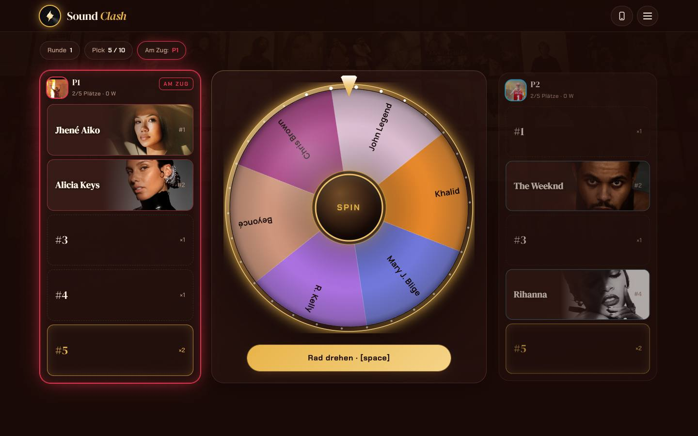
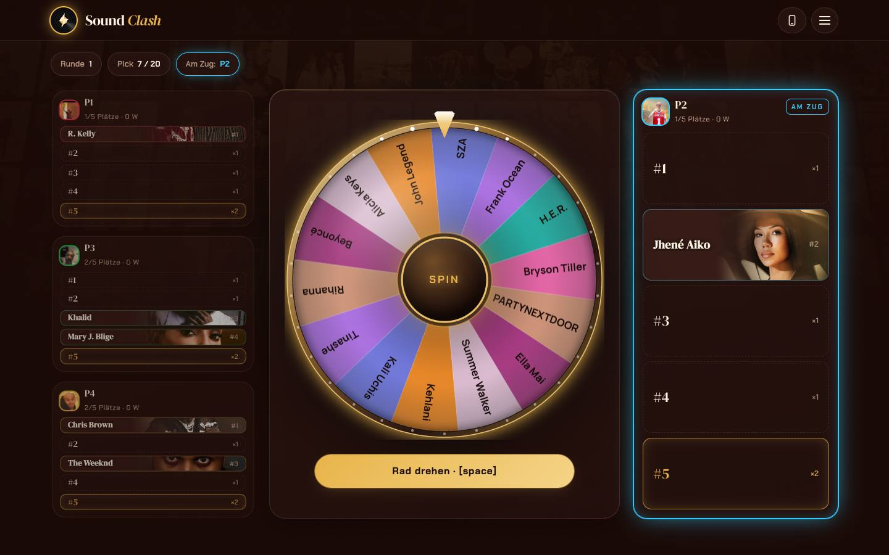
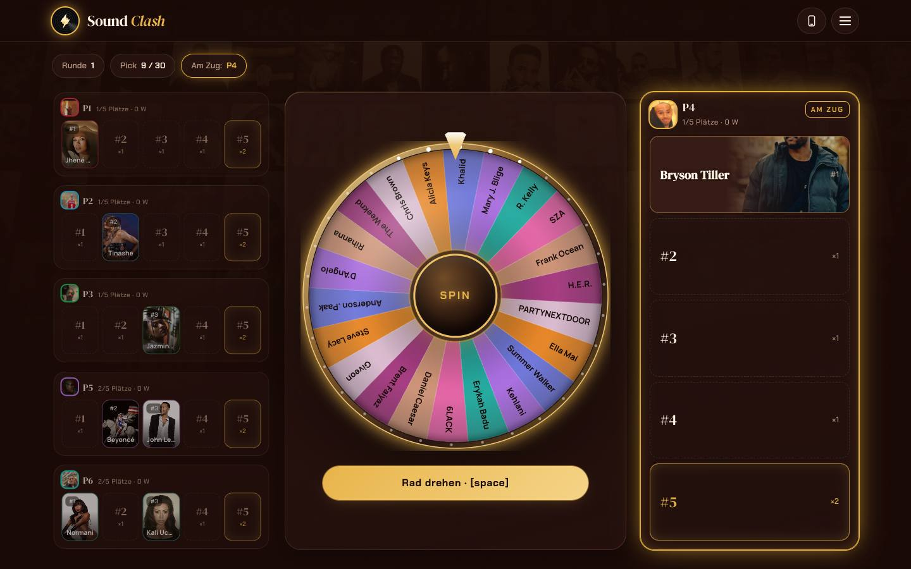
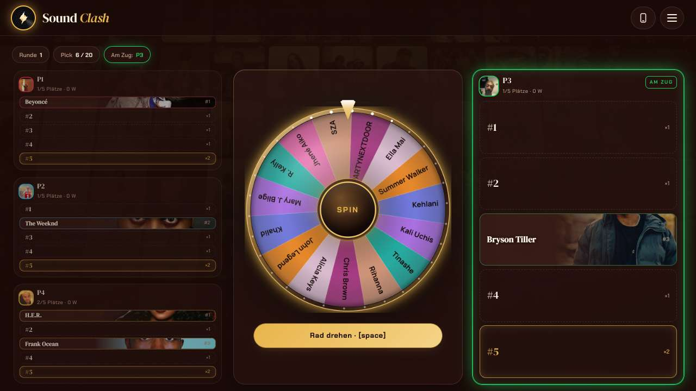
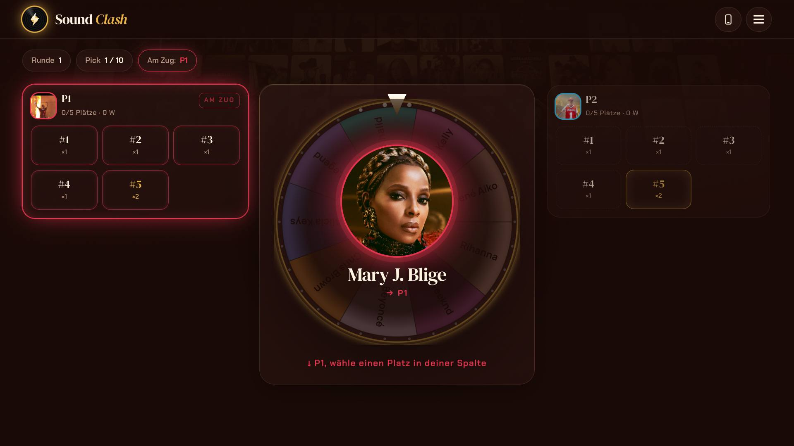

# Sound Clash – Bericht: Startseite, Fernseher, Überblendungen

Hallo Tim, hier ist die neue Runde. Live ist noch nichts geändert; dafür brauchst du nur einen Klick
(ganz unten).

## Was neu ist

**Startseite – minimalistisch** (deine Wahl: kompakt, eine Seite)
- Oben groß „Sound Clash“ und darunter „Wie wird gesteuert?“.
- **① Spieler** und **② Künstler-Topf** sind immer sichtbar und werden immer selbst gewählt.
- **Regeln** stehen nur noch als **eine Zeile** da, z. B. „5 Songs · Einzelrunde · Vor jedem Duell ·
  Publikum stimmt ab“ mit dem Abzeichen **„Schnellstart“**. Antippen klappt alle Einstellungen auf.
  Wer etwas ändert, behält es (wie bisher). „↺ Auf Schnellstart-Standard zurücksetzen“ stellt alles
  zurück.
- Unten zeigt ein Fortschrittsbalken, wie voll der Künstler-Topf schon ist; dann „Match starten“.

**Fernseher** (Menü ☰ → Bildschirm: 💻 Laptop / 📺 Fernseher)
- „Fernseher“ macht die ganze Oberfläche groß genug für die Couch – egal ob der Mac per HDMI/AirPlay
  am Fernseher hängt oder gespiegelt wird. Die Größe passt sich dem Bildschirm an. Wird auf diesem
  Gerät gemerkt.

**Überblendungen zwischen den Spielphasen** (normaler Modus)
- Eine Fläche in den **Farben des gewählten Albums** gleitet mit leuchtender Kante **von links nach
  rechts** durchs Bild. Der Titel baut sich Wort für Wort auf, dann zieht die Fläche weiter und gibt
  die neue Szene frei. Alles flüssig, ohne Wartezeit.
- Titel statt „Drehrad“: **„Das Rad entscheidet“**, in den nächsten Runden **„Wer zieht wen?“** und
  **„Neue Runde, neues Glück“** · **„Song Battle 1, 2, 3 …“** mit großer Zahl (bei ×2-Plätzen
  „doppelte Punkte“, zuletzt „Das letzte Battle“) · danach kurz **„VS“** · **„Plattenkiste“**
  (alle Songs vorab) · **„Sudden Death – Ein Song. Eine Entscheidung.“** · **„Abpfiff“** am
  Rundenende · **„Die Krönung“** zum Endstand · **„Turnierbaum“**.
- Im Handy-Modus bleiben die Kino-Blenden (deine Wahl). Sie sind jetzt im dunklen Farbton des Albums
  statt in reinem Schwarz.

**Glücksrad und Spielfelder beim Ziehen**
- Rad deutlich größer (bis 540 px), mit metallischem Rand in der Album-Farbe, feinen hellen
  Trennlinien, Glas-Kuppel mit Lichtreflex, glänzendem SPIN-Knopf und neuem Zeiger.
- Spielfelder als **längliche Felder** #1 … #5 untereinander; das Künstlerfoto liegt nur dezent
  rechts im Feld, der Name bleibt gut lesbar.
- **2 Spieler:** links und rechts vom Rad, beide groß (so wie es dir gefallen hat).
- **3–4 Spieler:** Wer am Zug ist, steht **rechts groß**, die anderen links als kompakte Felder.
- **5–6 Spieler:** Rechts ebenfalls groß der Spieler am Zug, links die anderen als **Kachel-Leisten**
  (Künstlerfoto als Kachel, Platznummer als Abzeichen, Name unten), nach unten verlängert.
- Rad-Feld und Spielfelder enden unten **auf einer Linie**.

**Kein Scrollen während des Spiels**
- Ziehen, Songwahl, Aufdecken und Duell passen immer auf den Bildschirm – im normalen und im
  Handy-Modus. Das Spielfeld füllt die Höhe, die Kacheln enden unten bündig mit dem Bildschirm.
- Ist ein Bildschirm kleiner (z. B. 1280 × 720) oder der Inhalt größer, wird automatisch passend
  verkleinert. Lange Songlisten scrollen nur in ihrem Kasten.
- Scrollen geht nur noch auf der Startseite und beim Rundenende/Endstand. Am Handy hochkant
  bleibt das Scrollen, sonst würde alles zu klein.

## Geprüft

- Alle Vergleichstests gegen das Original sind grün. Spielmechanik, Texte und gespeicherte Daten sind
  unverändert.
- Neuer Test: Regeln eingeklappt mit Schnellstart, Ändern und Zurücksetzen, Fernseher-Modus (wird
  größer, läuft nicht seitlich über, bleibt nach Neuladen).
- Fernseher geprüft mit 1920 × 1080: Startseite, Rad und Songwahl passen auf den Bildschirm.
- Ziehen geprüft mit 2, 3, 4, 5 und 6 Spielern (MacBook-Größe 1440 × 900), dazu 1280 × 720,
  Fernseher 1920 × 1080 und Handy-Modus: kein Scrollen, Kacheln enden unten bündig.

## Bilder

Überblendung „Das Rad entscheidet“ (vier Momente, von links oben nach rechts unten):

| Startseite am Mac | Startseite am iPhone |
|---|---|
|  |  |

| Ziehen · 2 Spieler | Ziehen · 4 Spieler | Ziehen · 6 Spieler |
|---|---|---|
|  |  |  |

| Kleiner Laptop 1280 × 720 · 4 Spieler | Handy-Modus am Mac |
|---|---|
|  |  |

| Fernseher: Menü | Fernseher: Startseite | Fernseher: Rad |
|---|---|---|
|  |  |  |

## Deine Frage zum Handy-Modus

Ja, der Mac-Bildschirm im Handy-Modus ist so umgebaut, wie du es beschrieben hattest, und er ist live.
Ich habe die veröffentlichte Seite geprüft: Sie enthält das Rad als Einblendung, das Aufdecken
Spieler für Spieler und das Versus mit den Stimmen. Damit du ihn siehst:

1. In der Einrichtung **„📱 Mit den Handys“** wählen. Bei „An diesem Gerät“ bleibt alles wie im Original.
2. Die App lädt eine neue Version auf der Startseite von selbst; mitten im Spiel erscheint
   **„Neue Version bereit · Aktualisieren“** – antippen. Hilft das nicht: Seite einmal mit `?neu=1`
   öffnen, am iPhone die App ganz schließen und neu starten.

Die Bilder dazu: [Ziehen](screenshots/mac-15-handymodus-ziehen.jpg),
[Rad-Einblendung](screenshots/mac-15c-handymodus-gezogen.jpg),
[Aufdecken](screenshots/mac-17-handymodus-aufdecken.jpg),
[Song läuft](screenshots/mac-18-handymodus-song-laeuft.jpg),
[Versus](screenshots/mac-19-handymodus-versus.jpg).

## Deine nächsten Schritte (veröffentlichen)

1. **GitHub Desktop** öffnen. Oben bei **Current Branch** sollte **`main`** stehen.
2. Oben rechts **Push origin** klicken.
3. Auf GitHub unter **Actions** warten, bis der oberste Eintrag einen grünen Haken hat (2–3 Minuten).
4. **v6fdb8msrw-dotcom.github.io/SoundClashBeta/?neu=1** öffnen.
