# Sound Clash 2 – Bericht

Hallo Tim, der Umbau ist fertig und liegt auf dem Branch `react-umbau`. Live ist noch nichts geändert;
das passiert erst mit deinen Schritten unten.

## Kurz gesagt

- **Spielmechanik unverändert:** Clash, Turnier, Sudden Death, Best of 3/5, Guess the Song, Timeline
  und Jahrzehnt-Duell laufen exakt wie vorher. Das ist nicht nur vermutet, sondern automatisch geprüft
  (siehe unten).
- **Neue Technik:** React, TypeScript und Vite als PWA, genau wie Muscle Studio. Auf dem iPhone
  installierbar, auf dem Mac im Browser, startet auch offline.
- **Neues Aussehen:** eine futuristische „Neon-Bühne“ mit vielen Animationen. Deine 13 Album-Farben
  und die 5 Hintergründe gibt es weiterhin.
- **Handy-Begleiter (dein Wunsch):** Handys per QR-Code koppeln, dann am Handy abstimmen, das eigene
  Line-up sehen und selbst setzen und Songs wählen. Kostenlos, ohne Konto, ohne Server-Speicher.
- **Spielstände** bleiben nur auf dem Gerät. Alte Stände werden automatisch übernommen. Dazu gibt es
  Export und Import als Datei (AirDrop).

## So wurde die Mechanik abgesichert

1. `docs/MECHANIK.md` beschreibt alle Regeln, Bildschirme, Einstellungen, gespeicherten Daten und
   Deezer-Aufrufe des Originals.
2. Das Original liegt unverändert in `legacy/index.html`.
3. Automatische Tests spielen dieselben Partien im echten Chrome **gegen das Original und gegen die
   neue Fassung** und vergleichen alles: wer zieht, Plätze, Songs, Punkte, Sudden Death, Rundensiege,
   Endstand, Rückblick, Rivalität, Toasts und gespeicherte Daten. **Ergebnis: identisch.**
   - Clash mit 2 Spielern und Publikumsabstimmung; mit 3 Spielern, Best of 3, „Alle vorab“ und
     Gleichstand mit Sudden Death; mit „Gleicher Künstler für alle“, Pick-Timer, Überspringen und
     Song von Hand
   - Turnier mit 4 Spielern bis zum Turniersieger
   - Guess the Song, Timeline Masters, Jahrzehnt-Duell
   - Speichern und Neustart aller Einstellungen
4. **Live-Test mit echter Deezer-Hörprobe:** Die 30-Sekunden-Vorschau spielt im echten Browser,
   in alter und neuer Fassung. Die Spotify- und YouTube-Links führen zur selben Suche wie vorher.
5. Zusätzlich getestet: Übernahme alter Spielstände (Muscle-Studio-Daten bleiben unberührt),
   Export/Import, PWA mit Offline-Start, Handy-Begleiter mit Hauptgerät und zwei Handys.

## Bilder

| Mac | iPhone |
|---|---|
| 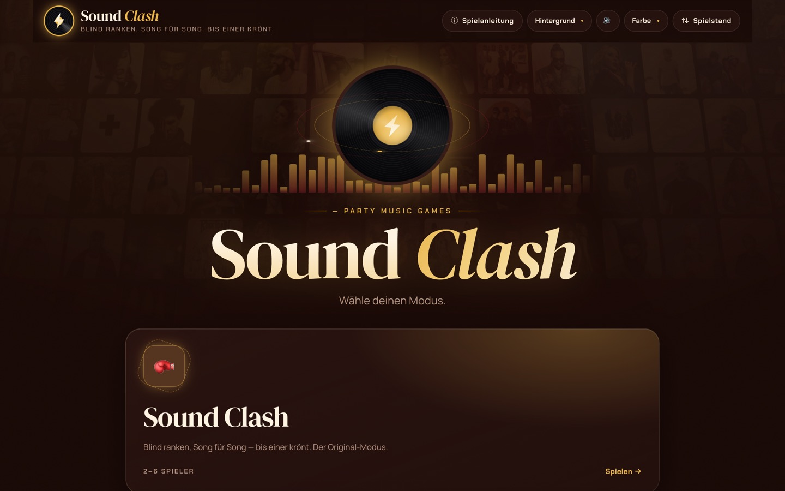 | 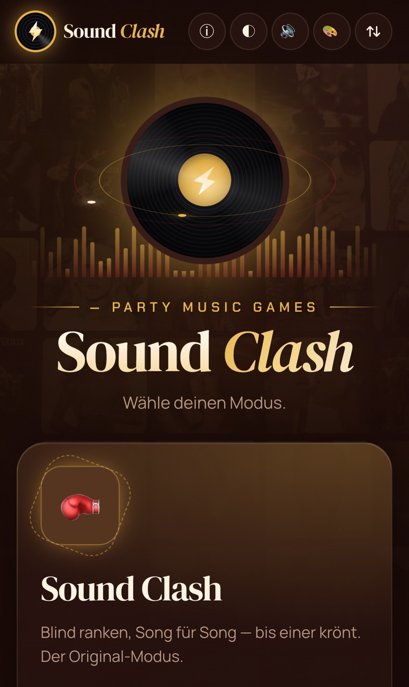 |
| 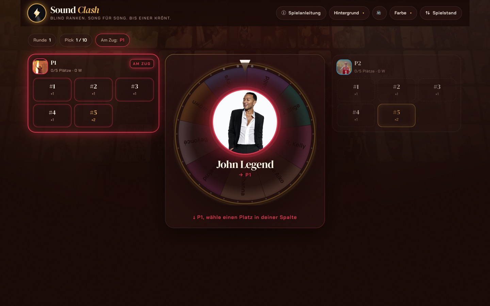 | 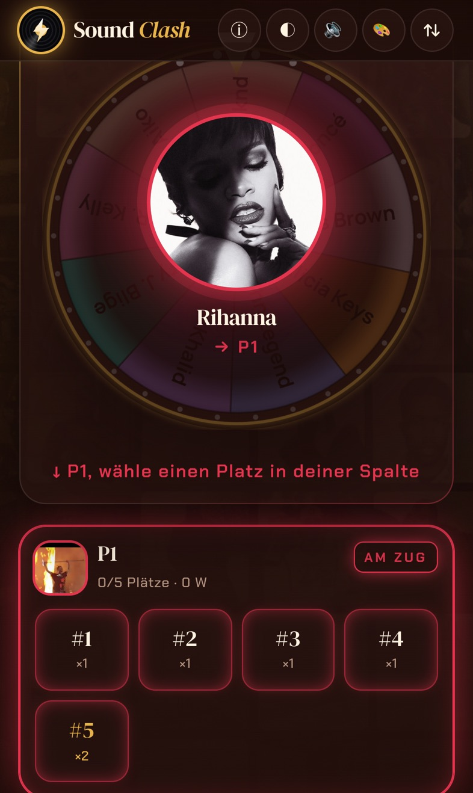 |
| 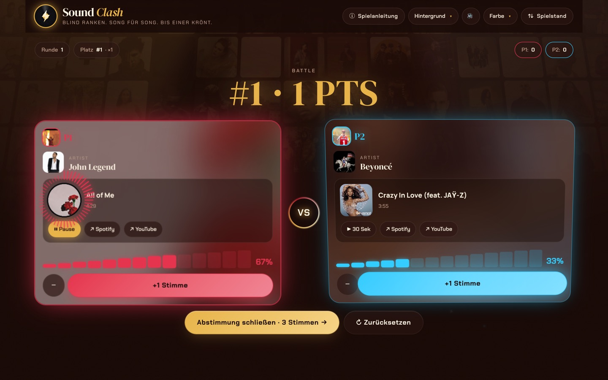 | 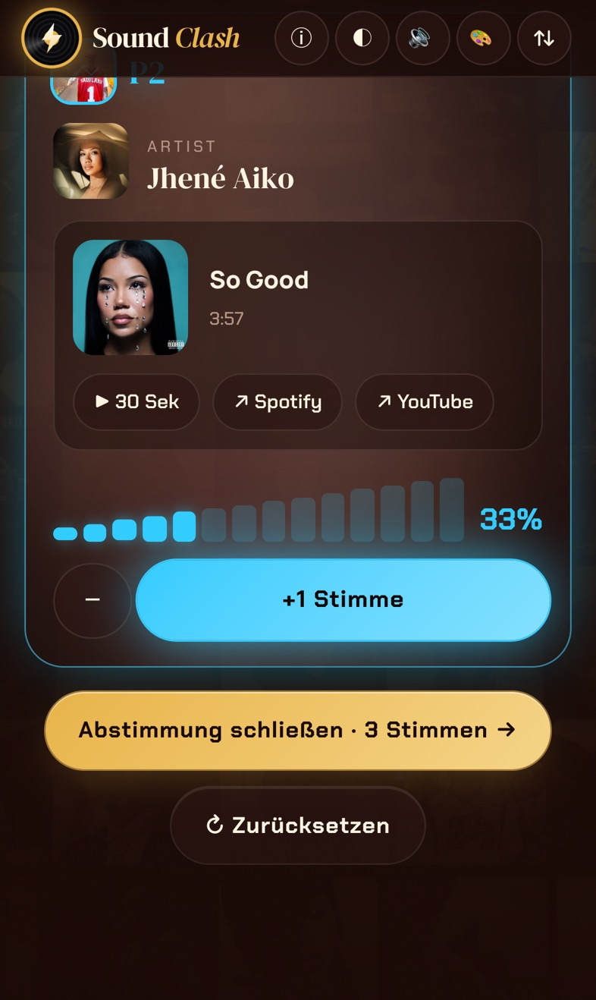 |
| 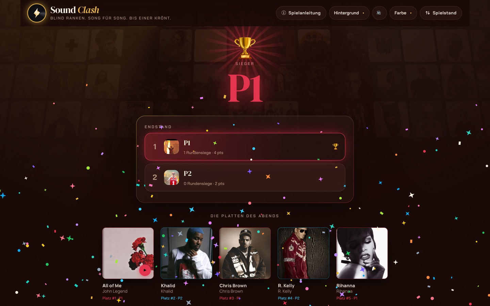 | 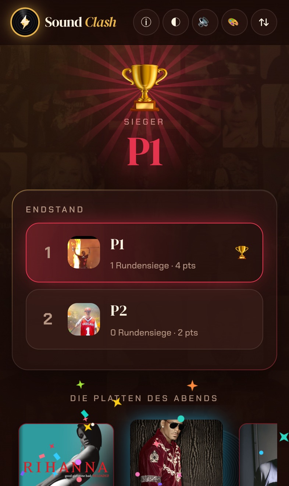 |
| 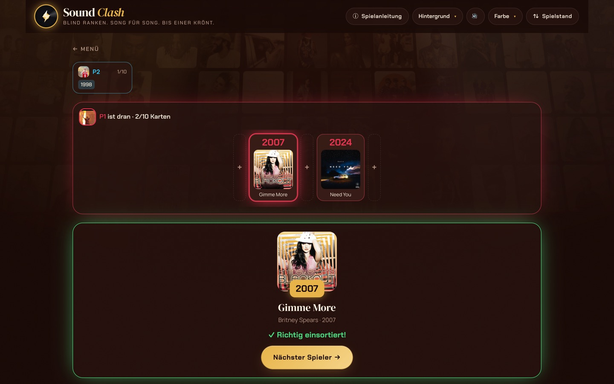 | 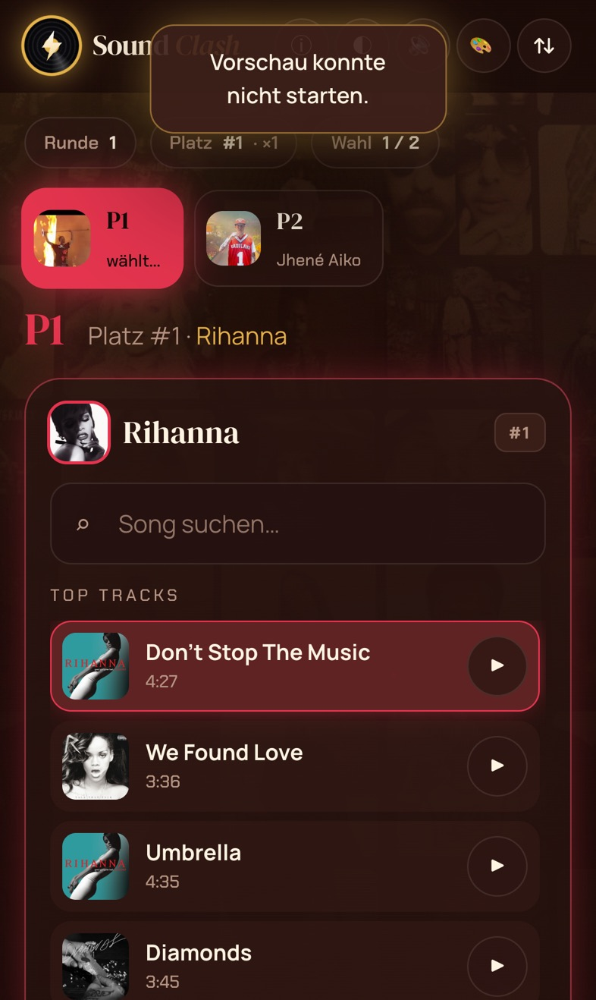 |
| 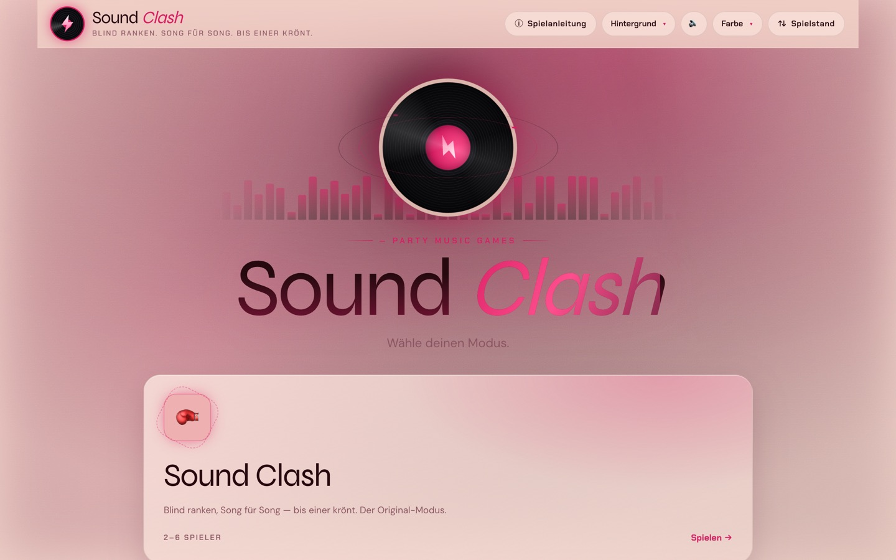 | 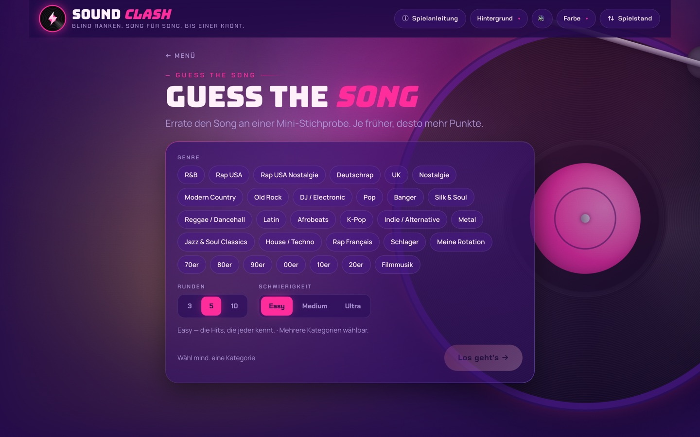 |

Handy-Begleiter (in den Test-Bildern sind Cover durch Platzhalter ersetzt):

| Koppeln am Hauptgerät | Blind setzen am Handy | Abstimmen am Handy |
|---|---|---|
| 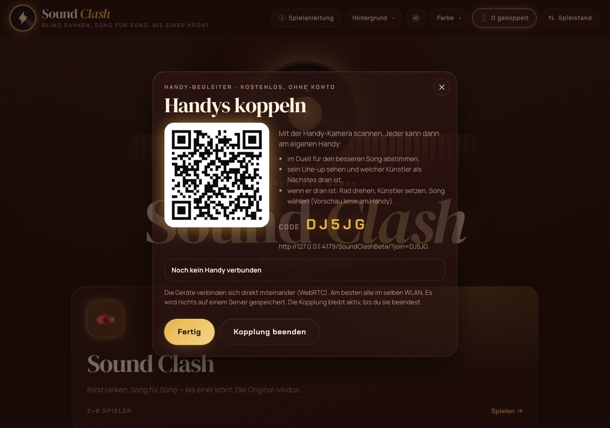 | 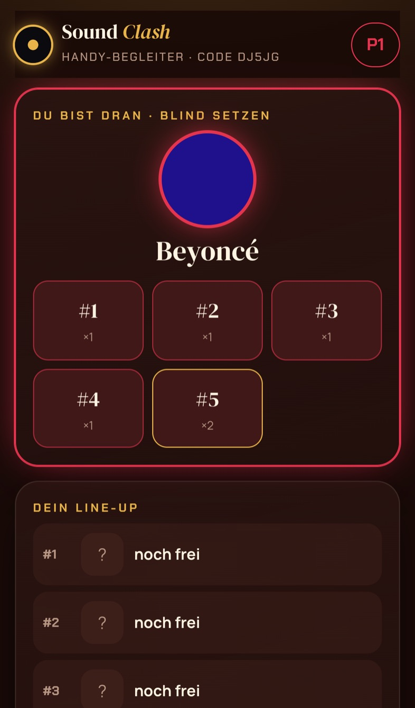 | 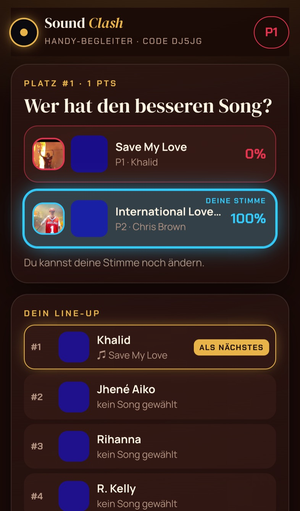 |

## Meine Gestaltungsideen (umgesetzt)

1. **Neon-Bühne:** Glasflächen mit Lichtkante, HUD-Beschriftungen und ein Holo-Raster am Boden
   mit Lichtkegeln. Alles färbt sich passend zum gewählten Album-Theme.
2. **Startbildschirm:** schwebende Platte mit Orbit-Ringen und Equalizer. Die Modus-Kacheln neigen
   sich in 3D zur Maus und haben eine umlaufende Lichtkante.
3. **Bildschirmwechsel mit Federphysik:** Neue Bildschirme federn mit kurzer Unschärfe herein.
   Jedes Duell und jede Songwahl kommt als eigene Karte.
4. **Glücksrad neu:** Leuchtring mit 30 LED-Punkten. Der Zeiger schnippt bei jedem Tick, schnelle
   Drehung wirkt unscharf. Beim Aufdecken fliegt das Künstlerbild mit Schockwelle und Funken in der
   Spielerfarbe herein. Auf dem iPhone dreht ein Wischen über das Rad.
5. **Blind setzen:** Freie Plätze pulsieren. Der gesetzte Künstler springt mit Feder ins Feld,
   begleitet von Funken.
6. **Duell-Arena:** Die Karten fliegen gedreht herein, dazwischen ein leuchtender VS-Ring. Das
   laufende Cover wird zur drehenden Platte mit **Frequenz-Ring**. Auf dem Mac zeigt er echte
   Frequenzen, weil Deezer CORS erlaubt; auf dem iPhone ist er simuliert, damit Safari die Vorschau
   nicht stumm schaltet. Der Sieger leuchtet auf, die anderen werden grau und kippen weg.
7. **Plattenspieler-Hintergrund:** Ein Frequenz-Ring liegt um die Platte, und die Album-Wand pulsiert
   zur Lautstärke.
8. **Runden- und Endstand:** Zahlen zählen hoch, der Pokal bekommt einen Strahlenkranz, dazu Konfetti
   mit Sternen. In „Die Platten des Abends“ rutscht beim Antippen die Platte aus der Hülle und dreht sich.
9. **Knöpfe:** Glanz-Wischer beim Überfahren, Feder beim Tippen, und „Los“-Knöpfe pulsieren, sobald
   sie bereit sind.
10. **iPhone:** Safe Areas, kompakte Kopfleiste und Setup-Tabs, zwischen denen man wischen kann.
    Die Startleiste bleibt unten stehen.
11. **Reduzierte Bewegung:** Wer in den Systemeinstellungen „Bewegung reduzieren“ an hat, bekommt
    eine ruhige Fassung mit sofortigen Wechseln, ohne Partikel und Schwenks.

Weitere Ideen, noch **nicht** gebaut, gerne auf Zuruf: ein Vollbild-„Party-Modus“ für Fernseher oder
Beamer, eine Wandfarbe aus der Coverfarbe des laufenden Songs und unterschiedliche Vibrationsmuster
pro Ereignis am Handy.

## Handy-Begleiter

Am Hauptgerät oben **📱 Handys** tippen und den QR-Code mit der Handy-Kamera scannen. Am Handy
wählt jeder, wer er ist (P1 … P6 oder „Nur abstimmen“).
- **Abstimmen:** Im Duell tippt jeder seinen Favoriten an. Eine Stimme pro Handy, Wechsel möglich.
- **Mein Line-up:** Plätze, Künstler, gewählte Songs und „als Nächstes“.
- **Wenn ich dran bin:** Rad drehen, Künstler blind setzen, Song wählen. Die Hörprobe läuft leise
  am eigenen Handy, dann bestätigen.
- Die Regeln bleiben gleich: Das Handy macht nur, was man auch am Hauptgerät tippen könnte.
- Die Geräte verbinden sich direkt miteinander. Am besten sind alle im selben WLAN.

## Spielstände

- Gespeichert wird nur auf dem jeweiligen Gerät, unter eigenen Schlüsseln (`soundclash.app.…`),
  damit nichts mit Muscle Studio kollidiert.
- **Alte Spielstände** (Einstellungen, Namen, eigene Avatare, Topf, ewige Rivalität) werden beim ersten
  Öffnen automatisch übernommen. Wichtig fürs iPhone: Öffne die neue Version beim ersten Mal über das
  **bestehende** Home-Bildschirm-Symbol. iOS gibt jeder installierten Web-App einen eigenen Speicher.
- **Spielstand-Knopf** oben: „Senden“ erzeugt eine Datei, am iPhone öffnet sich direkt AirDrop.
  Auf dem anderen Gerät wählst du „Datei übernehmen“.

## Deine nächsten Schritte

1. **GitHub Desktop** öffnen → *File → Add Local Repository…* → Ordner `sound-clash` in deinem
   Benutzerordner wählen.
2. Oben den Branch **`react-umbau`** wählen → **Publish branch** bzw. **Push origin**. Die Live-Seite
   bleibt dabei noch die alte.
3. Auf github.com im Repository **SoundClashBeta** → **Settings → Pages → Source: „GitHub Actions“**
   einstellen.
4. In GitHub Desktop auf **`main`** wechseln → *Branch → Merge into Current Branch…* →
   **`react-umbau`** wählen → **Push origin**. GitHub baut die Seite dann automatisch. Unter
   *Actions* wird es nach etwa 2 Minuten grün.
5. https://v6fdb8msrw-dotcom.github.io/SoundClashBeta/ öffnen. Am iPhone in Safari geht es über
   *Teilen → Zum Home-Bildschirm*, oder du nimmst das bestehende Symbol, siehe oben.

Wichtig: Schritt 3 vor Schritt 4. Sonst würde GitHub den Quellcode direkt als Seite ausliefern.

## Fragen an dich

Beim genauen Durchgehen des Originals sind mir ein paar Dinge aufgefallen. Ich habe sie **nicht**
geändert, weil die Mechanik unverändert bleiben sollte. Sag mir jeweils, ob ich sie ändern soll:

1. **Turnier leert den Topf:** Jedes Match zieht aus demselben Topf. Mit der verlangten Mindestzahl
   ist der Topf ab dem 2. Match leer, und das Rad zeigt „Topf ist leer“. Für ein Turnier mit 4
   Spielern braucht man 30 Künstler bei 5 Songs.
2. **Turnier mit Best of 3/5:** „Nächste Runde“ führt ins Setup, und „Match starten“ legt dort einen
   neuen Turnierbaum an.
3. **Nach Sudden Death** zeigt der Rundenbildschirm nur die Sudden-Death-Punkte („Von 1“), nicht die
   Punkte der ganzen Runde.
4. **Sudden-Death-Platte:** Bei „Die Platten des Abends“ steht dort als Künstler „true“, und Teilen
   bricht ab, wenn diese Platte kein Cover hat.
5. **Pick-Timer und Auto-Scroll** werden nicht gespeichert. Nach einem Neustart sind sie wieder auf
   Standard.
6. Die **Spielanleitung** erwähnt „Respins“, die es im Spiel nicht gibt.
7. Zwei **Hinweistexte** sprechen noch von „Vorschau hier im Chat … Datei herunterladen und per
   Doppelklick öffnen“. Das passt nicht mehr zur App.
8. **Sing it Back** ist im Code vorhanden, hat aber keine Startkachel und bleibt deshalb unsichtbar
   wie bisher.
9. Eine kleine Schutzmaßnahme habe ich eingebaut: Nach „… gewinnt →“ sind die Duellkarten für den
   kurzen Ausblende-Moment (0,9 s) gesperrt. Im Original konnte ein versehentlicher Doppeltipp dort
   ein ganzes Duell überspringen. An den Regeln ändert das nichts. Soll das so bleiben?
