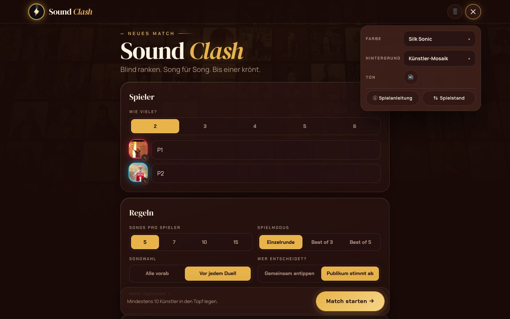
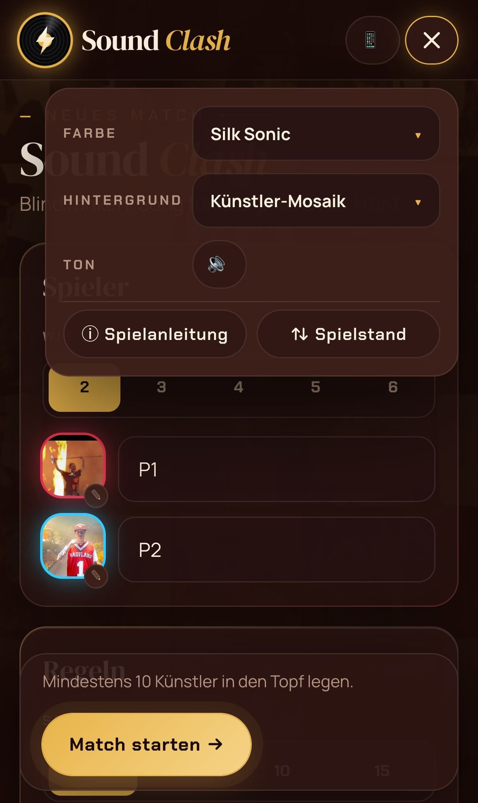
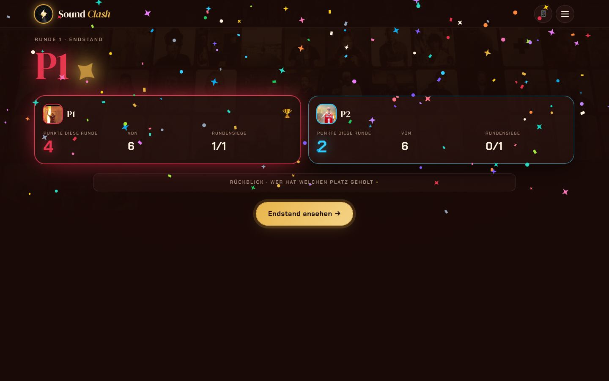
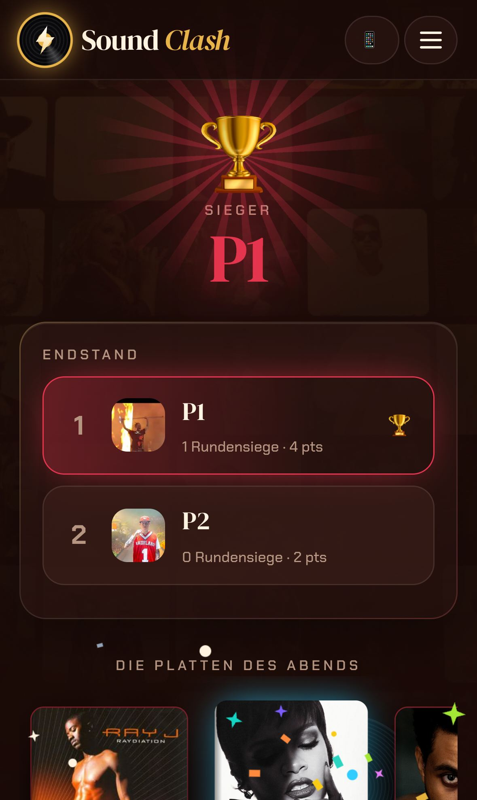
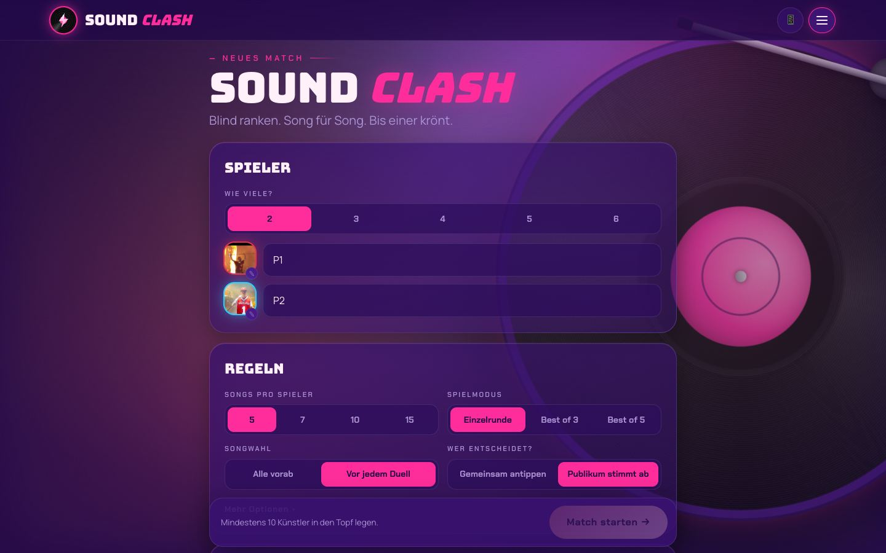

# Sound Clash 2 – Bericht

Hallo Tim, der Umbau ist fertig und liegt auf dem Branch `react-umbau`. Live ist noch nichts geändert;
das passiert erst mit deinen Schritten ganz unten.

## Kurz gesagt

- **Nur noch Sound Clash:** Die App startet direkt im Sound-Clash-Bildschirm. Guess the Song und
  Timeline sind ausgeblendet; ihr Code bleibt für später erhalten.
- **Spielmechanik wie im Original**, plus die Fehler, die du freigegeben hast, sind jetzt richtig (siehe unten).
  Beides ist automatisch geprüft.
- **Neues, schlichtes Interface** wie bei Muscle Studio: oben nur Logo, 📱 und ein Menü. Die
  Einrichtung steht in einer ruhigen Spalte, und alle Funktionen sind erhalten. Die Animationen bleiben:
  Glücksrad mit Leuchtring und Funken, Bildschirmwechsel mit Federphysik, Duell-Arena mit drehender
  Platte und Frequenz-Ring, Konfetti und Pokal.
- **Handy-Begleiter:** Handys per QR-Code koppeln, am Handy abstimmen, das eigene Line-up sehen und,
  wenn man dran ist, selbst setzen und den Song wählen. Kostenlos, ohne Konto und ohne Server-Speicher.
- **Technik wie Muscle Studio:** React, TypeScript und Vite als PWA. Auf dem iPhone installierbar,
  startet auch offline. Spielstände bleiben auf dem Gerät, alte werden übernommen, Export/Import per AirDrop.

## Was jetzt richtig ist (deine Freigabe)

1. **Turnier:** Jedes Match zieht wieder aus dem vollen Künstler-Topf. Vorher stand das Rad ab dem 2. Match still.
2. **Turnier mit Best of 3/5:** „Nächste Runde“ spielt dieselbe Paarung direkt weiter, statt einen
   neuen Turnierbaum anzulegen.
3. **Nach Sudden Death** zählen die Punkte der ganzen Runde plus der Sudden-Death-Punkt. Der Rückblick
   zeigt alle Plätze und die Sudden-Death-Zeile.
4. **„Die Platten des Abends“** zeigen beim Sudden Death den richtigen Künstler statt „true“, und Teilen klappt.
5. **Pick-Timer und Auto-Scroll** werden gespeichert.
6. **Spielanleitung** stimmt jetzt: keine „Respins“, richtige Angaben, die *letzten* Plätze zählen doppelt.
7. **Hinweistexte** reden nicht mehr vom „Chat“.
8. Bei Stimmengleichheit im Sudden Death stehen nur noch die Spieler zur Wahl, die antreten.
9. Ein Doppeltipp auf „… gewinnt →“ überspringt kein Duell mehr.

Alles andere verhält sich exakt wie im Original. Das prüfen automatische Tests im echten Chrome, die
dieselben Partien gegen Original und neue Fassung spielen: Clash mit 2 und 3 Spielern, Best of 3,
Sudden Death, gleicher Künstler, Pick-Timer, Turnier, Speichern und Neustart. Dazu kommt ein Live-Test,
bei dem die Deezer-Hörprobe wirklich spielt; die Spotify- und YouTube-Links führen zur selben Suche
wie vorher. Getestet sind außerdem Übernahme alter Spielstände, Export/Import, Offline-Start und der
Handy-Begleiter mit zwei Handys.

## Bilder

| Mac | iPhone |
|---|---|
|  |  |
|  |  |
|  |  |
|  |  |
|  |  |
|  |  |

Handy-Begleiter (in den Test-Bildern sind Cover durch Platzhalter ersetzt):

| Koppeln am Hauptgerät | Blind setzen am Handy | Abstimmen am Handy |
|---|---|---|
|  |  |  |

## So ist das Interface jetzt aufgebaut

- **Oben:** Logo (führt zum Start), **📱** zum Koppeln der Handys und **☰ Menü** mit Farbe
  (13 Album-Themes), Hintergrund, Ton, Spielanleitung und Spielstand.
- **Start = Einrichtung**, als eine Spalte:
  1. **Spieler:** Anzahl antippen, Namen eintragen. Ein Tipp auf den Avatar öffnet die Bildauswahl.
  2. **Regeln:** Songs pro Spieler, Einzelrunde/Best of 3/5, Songwahl und wer entscheidet, alles als
     Tipp-Schalter. Unter **„Mehr Optionen“** stehen Turnier, gleicher Künstler, Pick-Timer, Wand-Puls
     und Auto-Scroll.
  3. **Künstler-Topf:** Genre wählen oder suchen, mit „+“ hinzufügen. Der Topf erscheint als kleine Chips.
  4. Unten steht immer **„Match starten“**.
- Danach geht es weiter wie gewohnt: Rad, Songwahl, Duell, Runde, Endstand.
- Wer am Gerät „Bewegung reduzieren“ eingeschaltet hat, bekommt eine ruhige Fassung ohne Effekte.

## Deine nächsten Schritte

1. **GitHub Desktop** öffnen.
2. Oben im Menü **File → Add Local Repository…** → **Choose…** → im Benutzerordner `timsieg` den
   Ordner **`sound-clash`** wählen → **Add Repository**.
3. Oben in der Mitte auf **Current Branch** klicken → **`react-umbau`** auswählen.
4. Oben rechts **Publish branch** klicken und kurz warten. An der Live-Seite ändert sich dadurch noch nichts.
5. Im Browser **github.com/v6fdb8msrw-dotcom/SoundClashBeta** öffnen → oben **Settings** → links
   **Pages** → bei **Source** „**GitHub Actions**“ auswählen. Mehr ist dort nicht zu tun.
6. Zurück in GitHub Desktop: **Current Branch** → **`main`** auswählen.
7. Oben im Menü **Branch → Merge into Current Branch…** → **`react-umbau`** wählen →
   **Create a merge commit**.
8. Oben rechts **Push origin** klicken.
9. Im Browser im Repository oben auf **Actions** gehen und warten, bis der oberste Eintrag einen
   grünen Haken hat. Das dauert etwa 2–3 Minuten.
10. **v6fdb8msrw-dotcom.github.io/SoundClashBeta** öffnen. Am iPhone öffnest du die neue Version zum
    ersten Mal über das **bisherige Home-Bildschirm-Symbol**, dann werden deine alten Spielstände übernommen.

Wichtig: Schritt 5 muss vor Schritt 8 passieren.
