# Sound Clash – Bericht: Handy-Modus, Teil 2 (kinoreif)

Hallo Tim, deine Rückmeldung ist umgesetzt. Live ist noch nichts geändert; dafür brauchst du nur einen
Klick (ganz unten). Der normale Modus „An diesem Gerät“ ist unverändert.

## Was neu ist

**Einrichtung**
- Ganz oben: **„Wie wird gesteuert?“** – **🖥 An diesem Gerät** oder **📱 Mit den Handys**.
- Im Handy-Modus steht der QR-Code da, dazu jetzt der **Verbindungslink** mit „Link kopieren“ und
  „Teilen“ (z. B. für AirDrop oder den Gruppenchat).

**Ziehen (am Mac)**
- Oben groß der Spieler am Zug, darunter **sein Spielfeld groß**, darunter **klein die Spielfelder der
  anderen** (mit den Künstlern, die sie schon haben).
- Am Handy gibt es nur den Knopf zum Drehen. Sobald gedreht wird, wird das **Rad groß am Mac
  eingeblendet**, und am Handy sieht man es klein mitdrehen. Nach der Enthüllung verschwindet das Rad,
  und der Spieler setzt den Künstler am Handy.

**Aufdecken – Spieler für Spieler**
- Wenn alle gewählt haben: Überblendung „Alle haben gewählt“, dann ist **Spieler 1** dran. Am Mac
  steht nur er groß, mit Künstler und verdeckter Platte („Noch geheim“).
- Er drückt am Handy **▶ Song abspielen**: Titel und Cover erscheinen, der Song läuft am Mac.
  Am Handy gibt es Pause/weiter abspielen und **„Weiter“**. Nach 30 Sekunden geht es automatisch
  weiter (deine Wahl).
- Kurze Kino-Überblendung „P2 ist dran“, dann Spieler 2 nach demselben Prinzip.
- Die Reihenfolge rückt pro Duell um eins weiter (P1-P2, dann P2-P1 …).

**Versus**
- Wenn alle aufgedeckt haben, kommt der Versus-Screen wie der gewohnte Battle-Bildschirm, aber **nur
  mit dem gewählten Song** (ohne „30 Sek“, Spotify und YouTube).
- **Erst jetzt wird abgestimmt** (deine Wahl). Unter jedem Song sieht man, **wer dafür gestimmt hat**:
  Spieler mit Bild und Name, Zuschauer als „🙋 1 Publikum“. Darunter der Balken wie gewohnt.

**Überall im Handy-Modus**
- **Kino-Überblendungen** zwischen den Szenen: schwarze Blenden schließen sich, eine Titelkarte
  erscheint („Runde 1“, „Platz #2 · Songwahl am Handy“, „Alle haben gewählt“, „P2 ist dran“, „VS“),
  dann öffnet sich die neue Szene. Dazu eine leichte Vignette am Bildrand.

**Handy**
- **„Dein Line-up“ steht jetzt immer unten** – du siehst jederzeit, wen du als Nächstes hast.
- Beim Aufdecken sehen alle die Reihenfolge, was gerade läuft und welche Songs noch geheim sind.

**Hintergründe** (Menü ☰ → Hintergrund)
- **Künstler-Mosaik** ist wieder wie vorher (schwebt und pulsiert im Beat). Das wandernde Mosaik
  bleibt als eigene Wahl: **„Mosaik (wandernd)“**.
- **Plattenspieler** ohne die hellere Fläche hinter der Platte.
- Neu: **„Bühne (Lichtkegel)“** – Scheinwerfer in den Album-Farben schwenken durch Dunst und werden
  im Beat heller. **„Neon-Horizont“** – Sonne und Raster-Boden, der auf einen zuläuft.
- Die Album-Farbschemas sind geblieben. Beim Aufdecken gibt es keine Hülle und keinen Leuchtring
  mehr hinter der Platte.

## Geprüft

- Der Modus „An diesem Gerät“ verhält sich weiter **exakt wie das Original**: Alle Vergleichstests sind grün.
- Der Handy-Modus-Test koppelt echt per Internet: MacBook, 2 Spieler-Handys und 1 Zuschauer, der mitten
  in der Runde dazukommt. Geprüft sind: Drehen und Setzen nur am Handy, gleichzeitige Songwahl,
  Aufdecken per Play, Pause, weiter abspielen und „Weiter“, kein Abstimmen vor dem Versus, und
  dass am Mac steht, wer wofür gestimmt hat.
- Logik-Tests für Aufdecken (Play/Pause) und die Reihenfolge.

## Bilder

In den Test-Bildern sind Cover und Künstlerbilder durch Platzhalter ersetzt; in der App siehst du die echten.

Am Mac:

| Ziehen: Spielfeld groß | Rad wird eingeblendet |
|---|---|
|  | 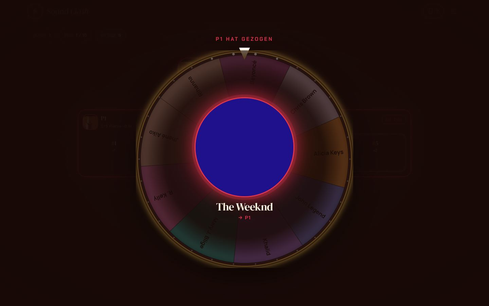 |
| **Überblendung** | **Aufdecken: Spieler 1 ist dran** |
|  | 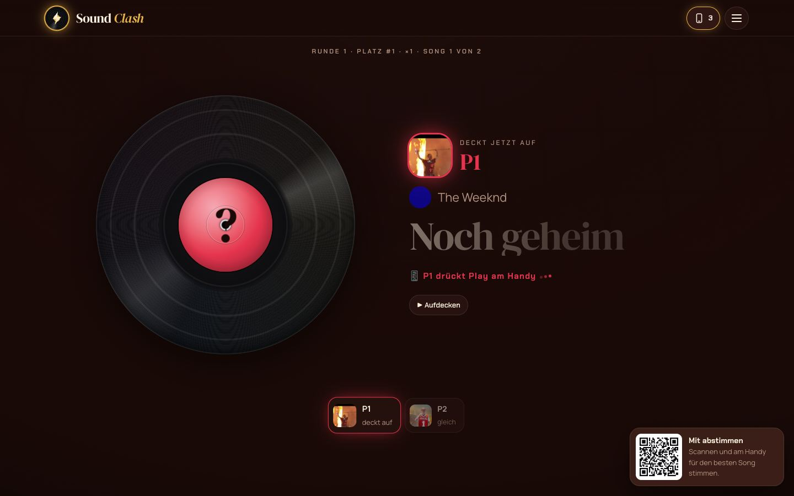 |
| **Song läuft** | **Versus: wer hat wofür gestimmt** |
| 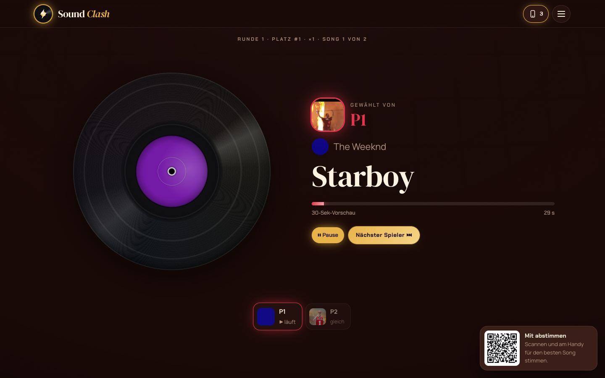 | 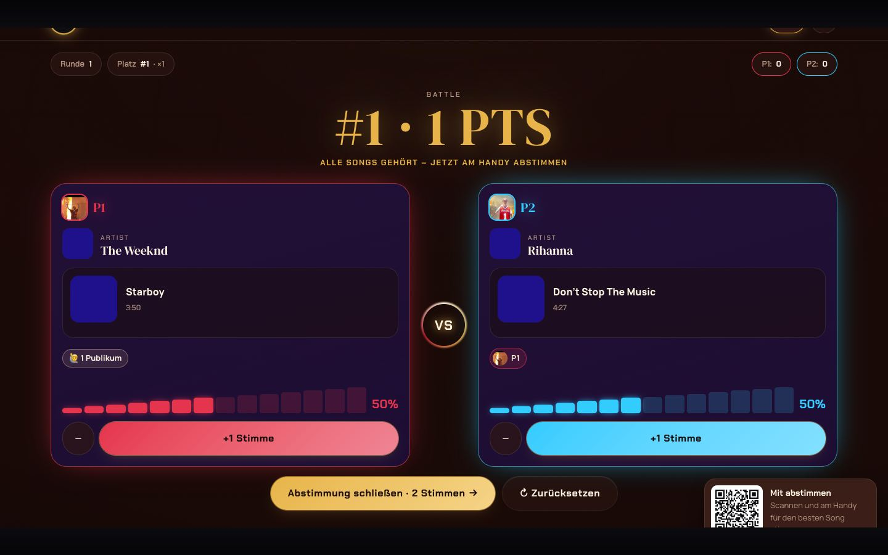 |

Am Handy:

| Rad dreht | Du bist dran | Läuft gerade (Zuschauer) | Abstimmen |
|---|---|---|---|
| 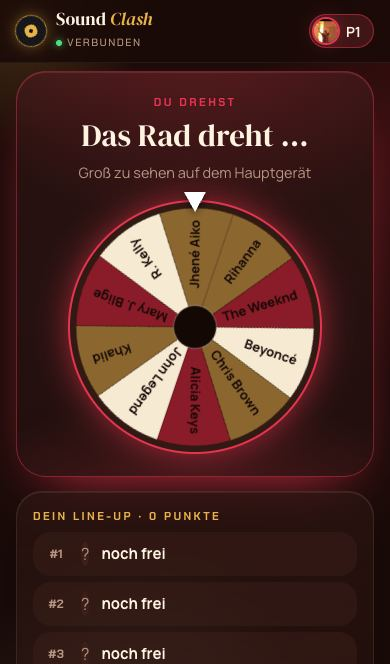 | 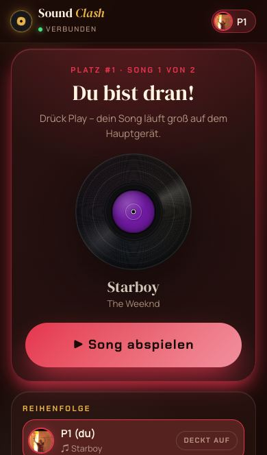 | 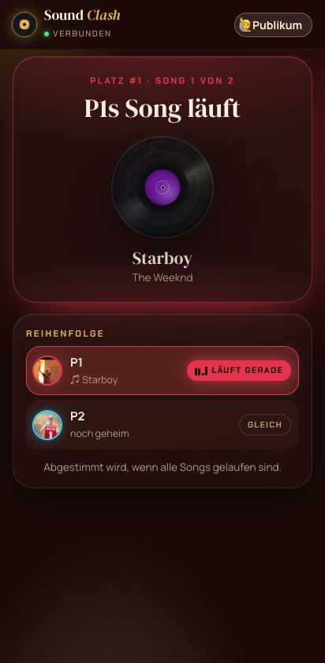 | 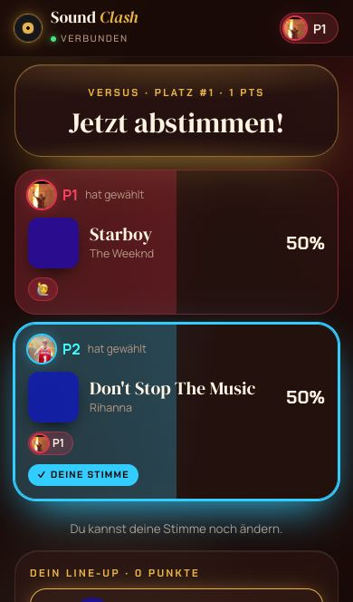 |

Hintergründe:

| Künstler-Mosaik (wie vorher) | Bühne (Lichtkegel) | Neon-Horizont | Plattenspieler |
|---|---|---|---|
| 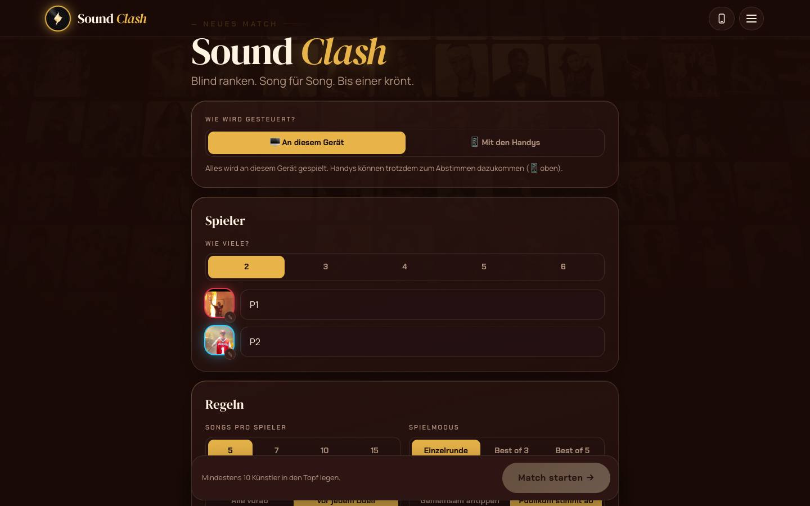 | 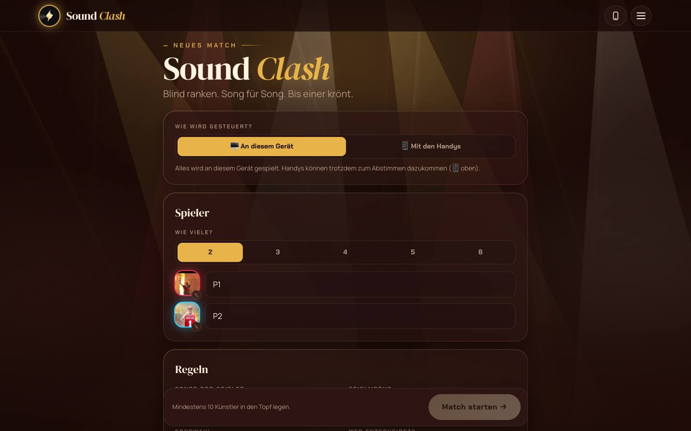 | 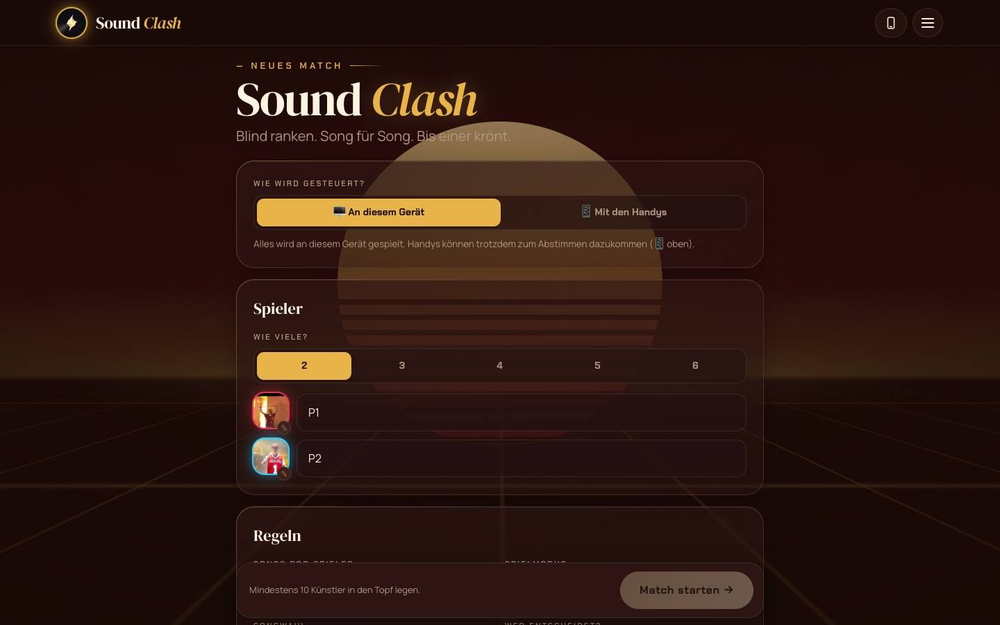 | 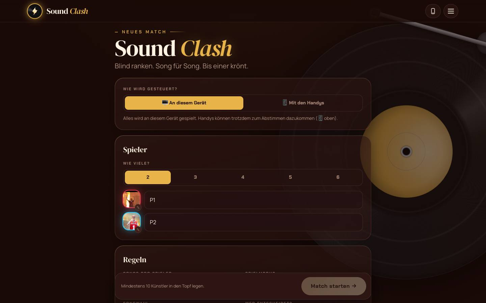 |

## Deine nächsten Schritte (veröffentlichen)

1. **GitHub Desktop** öffnen. Oben bei **Current Branch** sollte **`main`** stehen
   (sonst draufklicken und `main` wählen).
2. Oben rechts **Push origin** klicken.
3. Im Browser **github.com/v6fdb8msrw-dotcom/SoundClashBeta** → oben **Actions**. Warten, bis der
   oberste Eintrag einen grünen Haken hat (etwa 2–3 Minuten).
4. **v6fdb8msrw-dotcom.github.io/SoundClashBeta/?neu=1** öffnen. Am iPhone die App einmal ganz
   schließen und neu öffnen.

## Noch offen

Die Kino-Überblendungen gibt es nur im Handy-Modus, damit der normale Modus unverändert bleibt.
Sag Bescheid, wenn du sie auch dort haben möchtest. Offen ist auch noch die Frage aus dem letzten
Bericht: Soll die Songwahl im normalen Modus auch „immer eins weiter“ gehen statt hin und her?
